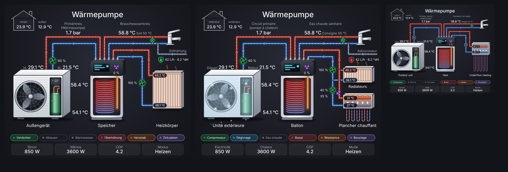
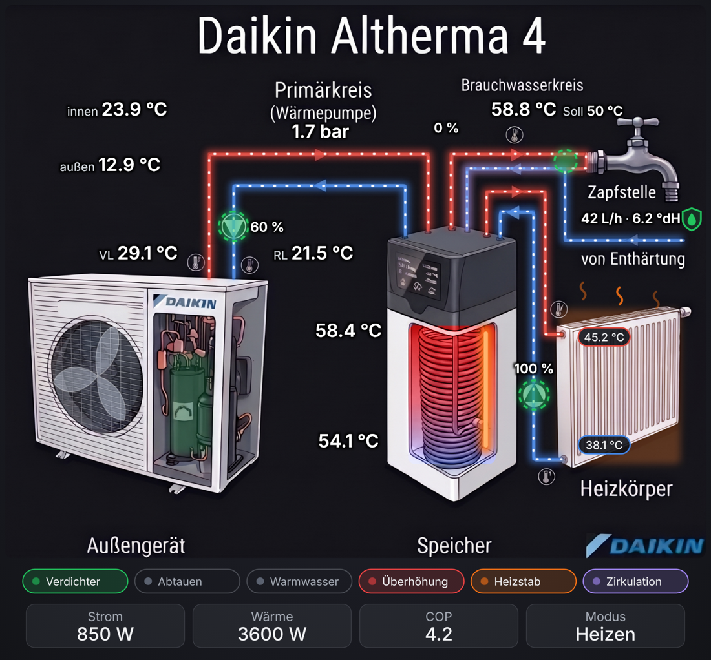

# Wärmepumpen Flow Card

Animierte Home-Assistant-Karte für Wärmepumpen – entworfen für die **Daikin Altherma 4 mit ECH₂O-Speicher**, aber mit jeder Wärmepumpe nutzbar.



**Bild-Modus** mit eigenem Hintergrundbild:



## Funktionen

- Außengerät mit drehendem Lüfter (Verdichter läuft) und Abtau-Animation (Frost, Eiskristalle, Tropfwasser)
- Umwälzpumpen mit drehendem Laufrad – Geschwindigkeit folgt der Pumpenleistung in %
- Wasserfluss in den Rohren mit einheitlich ausgerichteten Richtungspfeilen, sobald die jeweilige Pumpe läuft
- Innen-/Außentemperatur als Haus-Symbol
- VL/RL-Temperaturen direkt an den Anschlüssen von Heizkörper bzw. FBH
- Optionaler Strang „Enthärtung“ mit Durchsatz, Härtegrad und Leckageschutz-Symbol (grün = ok, gelb = abgesperrt, rot = Leck)
- Sprachen: Deutsch, English, Français, Nederlands, Italiano
- Speicher mit Innengerät, Wärmetauscher-Wendel mit temperaturabhängiger Färbung, senkrechtem Heizstab und Mischer
- Warmwasser mit Zirkulationspumpe, Sollwert, Speicherüberhöhung (leistungsstark)
- Wärmeverteilung wählbar: **Heizkörper**, **Fußbodenheizung** oder **beides** (2 Heizkreise mit Pumpe und Mischer)
- Strom, Wärme, COP und Betriebsmodus in der unteren Leiste
- Alle Datenpunkte im visuellen Editor auswählbar, nicht belegte werden ausgeblendet
- Klick auf einen Wert öffnet den Detail-Dialog der Entität
- Skaliert von der kleinen Karte bis zum Vollbild-Panel

## Bild-Modus (eigenes Hintergrundbild)

Statt der gezeichneten Grafik kann ein eigenes Bild verwendet werden. Die Karte legt Wasserfluss, Lüfter, Abtauen, Heizstab, Pumpen, Speicherfärbung und alle Werte darüber.

1. Bild nach `/config/www/` kopieren (Dateiname ohne Leerzeichen), z. B. `/config/www/altherma_hk.png`
2. Im Editor unter „Eigenes Hintergrundbild“ `/local/altherma_hk.png` eintragen
3. Die Standard-Positionen passen zu den Altherma-4-Schemabildern. Für andere Bilder „Positionier-Raster anzeigen“ einschalten und unter „Positionen anpassen“ nur die Abweichungen eintragen (Angaben in % von Bildbreite/-höhe):

```yaml
overlay:
  labels:                 # [x, y] oder [x, y, "start"|"end"]
    vl_temp: [19, 46]
  flows:                  # Punkte "x,y x,y ..." entlang des Rohrs
    primary_vl: "29.1,49.5 29.1,26.9 60.4,26.9 60.4,40.7"
  pumps:                  # [x, y, Radius]
    primary: [32.6, 40, 1.7]
  fan: [13.2, 67.1, 6.8, 10.6]          # Mitte x, y, Radius x, Radius y
  frost: "3.4,49.3 37.4,49.8 35.6,82.5 30.3,88.4 4.3,79.3"   # Umriss Außengerät
  compressor: [23.6, 63, 5.7, 18]       # x, y, Breite, Höhe
  tank: [57.5, 58, 12.5, 25]
  heater: [68.6, 59, 68.6, 80]          # Linie x1, y1, x2, y2
  emitters:
    z1: [79, 55, 17.4, 28]
```

Fluss-Schlüssel: `primary_vl`, `primary_rl`, `circ`, `soft`, `z1_vl`, `z1_rl`, `z2_vl`, `z2_rl`. Pumpen: `primary`, `z1`, `z2`, `circ`.

## Installation über HACS

1. HACS öffnen → oben rechts ⋮ → **Benutzerdefinierte Repositories**
2. Repository: `https://github.com/IngoPodolak/heatpump-flow-card`, Typ: **Dashboard**
3. „Wärmepumpen Flow Card“ suchen → **Herunterladen**
4. Browser neu laden (Strg+F5)

## Manuelle Installation

1. `heatpump-flow-card.js` nach `/config/www/` kopieren
2. Einstellungen → Dashboards → ⋮ → Ressourcen → `/local/heatpump-flow-card.js` als JavaScript-Modul hinzufügen

## Konfiguration

Karte im Dashboard hinzufügen und nach **„Wärmepumpen Flow Card“** suchen – alles weitere im Editor.
Ein vollständiges YAML-Beispiel für die Altherma 4 steht in [`beispiel-konfiguration.yaml`](beispiel-konfiguration.yaml).

| Option | Beschreibung |
|---|---|
| `title` | Titel (optional) |
| `heating_type` | `radiator`, `floor` oder `both` |
| `language` | `auto` (HA-Sprache), `de`, `en`, `fr`, `nl`, `it` |
| `softener` | `true` = Strang „Enthärtung“ anzeigen |
| `softener_flow`, `softener_hardness` | Durchsatz (l/h) und Härtegrad der Enthärtung |
| `leak_alarm`, `leak_valve` | Leckage erkannt (an = Alarm) / Absperrventil offen |
| `background_image` | Eigenes Hintergrundbild, z. B. `/local/altherma_hk.png` |
| `show_grid` | Positionier-Raster im Bild anzeigen |
| `overlay` | Positionen im Bild-Modus anpassen (siehe oben) |
| `theme_background` | `true` = Hintergrund vom HA-Theme statt dunkel |
| `zone1_mixer` | Mischerstellung im Innengerät (mischt Heizkreis und Wärmepumpenkreis) |
| `outdoor_temp`, `indoor_temp` | Außen-/Innentemperatur |
| `compressor` | Verdichter läuft |
| `defrost` | Abtauen aktiv |
| `vl_temp`, `rl_temp` | Vor-/Rücklauf Wärmepumpe |
| `pump`, `pump_speed` | Umwälzpumpe läuft / Leistung in % |
| `pressure` | Druck im Heizsystem |
| `power`, `heat_power`, `cop`, `mode` | Strom, Wärme, COP, Betriebsmodus |
| `dhw_temp`, `dhw_setpoint` | Brauchwasser Ist / Soll |
| `tank_top_temp`, `tank_bottom_temp` | Speicher oben / unten |
| `dhw_active`, `dhw_boost`, `heater_rod`, `circulation` | WW-Bereitung, Überhöhung, Heizstab, Zirkulation |
| `zone1_name`, `zone1_vl_temp`, `zone1_rl_temp`, `zone1_pump`, `zone1_pump_speed` | Heizkreis 1 |
| `zone2_…`, `zone2_mixer` | Heizkreis 2 (nur bei `both`), mit eigenem Mischer |

Ein-/Aus-Datenpunkte akzeptieren `binary_sensor`, `switch`, `input_boolean` oder Zahlen-Sensoren (> 0 = an).
Ist für einen Heizkreis keine Pumpe gewählt, gilt er als aktiv, wenn die Umwälzpumpe läuft und keine Brauchwasserbereitung aktiv ist.
